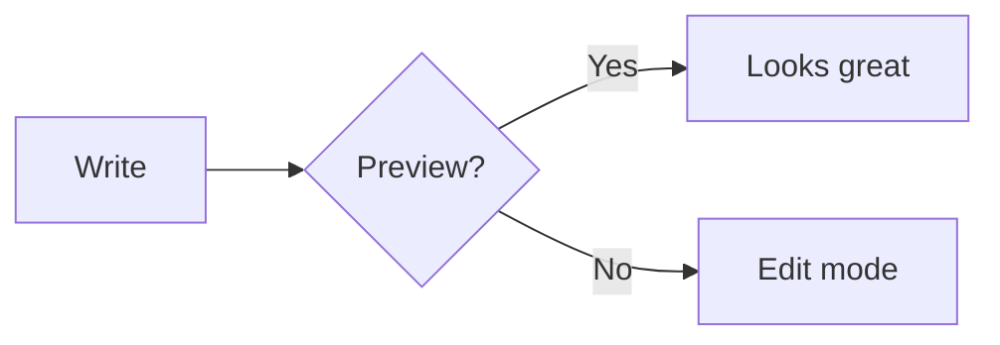
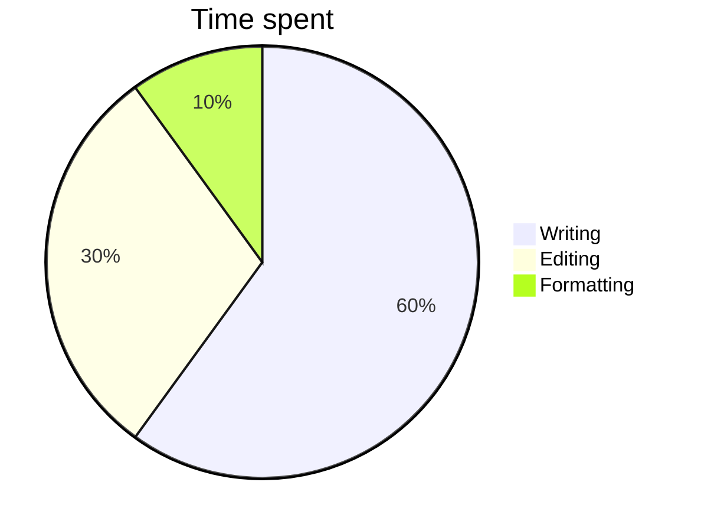
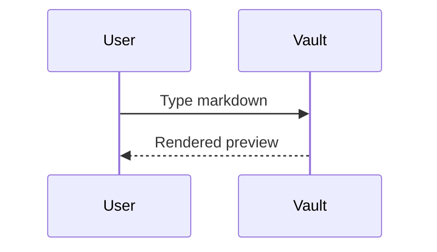

# Markdown showcase

Every format the live preview renders. Click into an image, diagram, table or formula to edit its source.

## Text

Some **bold**, *italic*, ***both***, ~~strikethrough~~, ==highlight==, `inline code`, H<sub>2</sub>O, x<sup>2</sup>, <kbd>⌘</kbd> + <kbd>S</kbd>, <u>underline</u> and <mark>marked</mark>.
Escaped: \*not italic\*. Emoji: :rocket: :tada: :+1:. Footnote reference[^1].

Setext heading
--------------

## Links

[[Another note]], [[Another note|with alias]], [web link](https://github.com), <https://example.com>, bare https://www.rust-lang.org and [jump to Tables](#tables). Hold ⌘ and click to open.

## Lists

- Bullet
  - Nested bullet
    - Deeper
1. First
2. Second
- [ ] Open task (click the box)
- [x] Done task

Term
: Definition list entry

## Quotes and alerts

> A plain quote with **bold** text.
> > Nested quote.

> [!NOTE]
> Useful information.

> [!TIP]
> A helpful tip.

> [!WARNING]
> Be careful.

> [!CAUTION]
> Something risky.

## Tables

| Feature | Status | Notes |
|:--------|:------:|------:|
| Images | ✅ | local + web |
| **Diagrams** | ✅ | Mermaid |
| Math | ✅ | `$...$` |

## Code

```rust
fn main() {
    let name = "vault";
    println!("Hello, {name}!"); // comment
}
```

```python
def greet(name: str) -> str:
    return f"Hello, {name}"
```

## Math

Inline: $E = mc^2$ and $\alpha + \beta$.

$$
x = \frac{-b \pm \sqrt{b^2 - 4ac}}{2a}
$$

## Diagrams







## Images


[](https://www.rust-lang.org) 

<p align="center"></p>

## HTML

<details>
<summary>Click to expand</summary>
Hidden details text.
</details>

<!-- This comment is invisible -->

---

[^1]: This is the footnote text.
